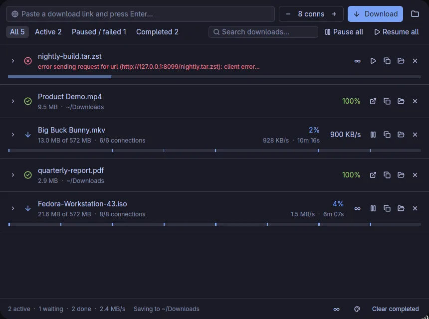

# Hurtle

An IDM-style download accelerator for Linux, Windows and macOS. It ships as a GPUI desktop app (built with [gpui-kit](https://gpui-kit.com)) plus a browser extension for Chrome-family browsers and Firefox.

**Website and downloads:** https://arafays.github.io/hurtle/

*Formerly called Surge. It was renamed in 0.2 to avoid confusion with an unrelated download manager of the same name.*



## Install

| System | One line |
| --- | --- |
| Linux, macOS | `curl -fsSL https://arafays.github.io/hurtle/install.sh \| sh` |
| Windows (PowerShell) | `irm https://arafays.github.io/hurtle/install.ps1 \| iex` |

Both scripts install for the current user (no sudo or admin rights), check the download against the release's `SHA256SUMS.txt`, and register the browser host. Linux goes to `~/.local`, macOS to `/Applications`, or `~/Applications` if that is not writable (override with `HURTLE_APPDIR`). To remove Hurtle on Linux and macOS, pass `--uninstall` (`… \| sh -s -- --uninstall`). On Windows, `iex` cannot take a parameter, so run `& ([scriptblock]::Create((irm https://arafays.github.io/hurtle/install.ps1))) -Uninstall`. Read the script first if you like: [install.sh](docs/install.sh), [install.ps1](docs/install.ps1).

Or take a file from the [latest release](https://github.com/arafays/hurtle/releases/latest):

- **Windows:** `hurtle-<ver>-windows-x86_64-setup.exe` (per-user installer), or the portable `.zip`.
- **macOS:** `hurtle-<ver>-macos-aarch64.dmg` or `…-x86_64.dmg`. Drag `Hurtle.app` to Applications. A Homebrew cask file is in [`packaging/macos`](packaging/macos); it is not in a tap yet.
- **Debian / Ubuntu:** `sudo apt install ./hurtle_<ver>_amd64.deb` (or `arm64`).
- **Arch:** the `hurtle-bin` PKGBUILD is in [`packaging/linux/aur`](packaging/linux/aur). It is not on the AUR yet; build it with `makepkg -si`.
- **Other Linux:** extract `hurtle-<ver>-linux-x86_64.tar.gz` (or `aarch64`) and run `./install.sh`, or run `./hurtle` directly.

The `.deb`, `setup.exe`, `.dmg` and the tarball's `install.sh` ship from 0.3.0 on. Windows and macOS builds are unsigned: SmartScreen may warn (More info, then Run anyway), and on macOS, if the app is blocked or "damaged", run `xattr -dr com.apple.quarantine /Applications/Hurtle.app`.

Then add the extension: unzip `hurtle-chrome-<ver>.zip` and use **Load unpacked** at `chrome://extensions` (keep the folder; it is not on the Chrome Web Store), or open `hurtle-firefox-<ver>.xpi` in Firefox 142 or newer, Zen or LibreWolf.

## Why it's faster

Many servers cap the speed of each connection. Hurtle downloads a file as byte-range **segments**, each over its own HTTP/1.1 connection, and uses **dynamic segmentation**, the same method IDM uses. When a connection finishes, it takes the largest unfinished segment, splits it in half and starts at the midpoint. Every connection stays busy until the end, so there is no slow straggler at the finish.

| Server capped at 512 KB/s per connection, 24 MB file | Time | Avg speed |
| --- | --- | --- |
| 1 connection | 48.2 s | 510 KB/s |
| 8 connections | 6.6 s | 3.7 MB/s |

Other details:

- **HTTP/1.1 only.** Under HTTP/2, every segment would share one TCP connection, and a per-connection cap would still apply.
- Segments write in place into a preallocated `name.part` file, so there is no merge step.
- The state is saved every 2 seconds and on quit. After a pause, quit or crash, the download resumes from the same position (saved positions never run ahead of the data written). Hurtle validates the size and ETag on resume and restarts if the file changed.
- **Fallback:** if a server doesn't support `Range`, Hurtle downloads over a single stream.
- Each connection retries with backoff. If it gives up, other connections pick up its segment.
- **Speed limits** are token buckets. There's one per download, shared by all its connections, and one global limit across all downloads. Both can change while a download is running.

## Layout

```
crates/hurtle-core   engine: probe, segments, dynamic splitting, limits, persistence, IPC, yt-dlp runner,
                     BitTorrent (librqbit), local stream server, player detection
crates/hurtle-app    `hurtle`: GPUI desktop app (single instance, listens on $XDG_RUNTIME_DIR/hurtle.sock)
crates/hurtle-host   `hurtle-host`: native-messaging host, relays browser → app, launches the app if needed
crates/hurtle-cli    `hurtle-cli`: headless downloader / `--send` to the running app
extension/          MV3 WebExtension → dist/chrome, dist/firefox
```

## Extension features

- **Catch browser downloads.** Hurtle pauses the browser's own download and opens the **Download file info** dialog. There you can rename the file and pick the connection count and speed limit. Then choose Start, Download later, Use browser, or Cancel.
- **Video and audio detection.** Hurtle sniffs media responses for each tab, and the toolbar badge shows how many it found. Hovering a `<video>` shows a floating **Download video** button. Files are named after the page title (`og:title` with the site-name suffix removed), so you get `My Video.mp4` instead of `videoplayback?id=…`.
- **Popup.** It lists the media captured on the current page and has the app's global connections and speed-limit settings, plus the interception options: on/off, dialog on/off, minimum size, and file types the browser should keep.
- **Download folders.** There is one main folder, plus optional folders for Videos, Music, Pictures, Documents, Archives and Programs. A file goes to its type's folder, or to the main folder if its type has none. You can set them in the app (the folder button next to Download), in the popup, or for a single download in the dialog's **Save to** row. "Change…" opens the system folder picker. The popup can change them even while the app is closed.
- **Context menu.** Right-click a link or video and choose **Download with Hurtle**.
- **Torrents.** Clicking a magnet link, or a download of a `.torrent` file, opens the dialog with the torrent's file list. Pick files, how long to seed, and whether to start playing right away.
- Cookies, the Referer and the User-Agent are forwarded, so downloads that need a login still work.

## Video sites and streams (yt-dlp)

YouTube and most video sites don't serve one file. The player fetches many small pieces, often with audio and video separate, from signed URLs. HLS (`.m3u8`) and DASH (`.mpd`) work the same way. Hurtle hands these to [yt-dlp](https://github.com/yt-dlp/yt-dlp), and ffmpeg merges the result into one file.

- **From the browser:**
  - The overlay button on a page with no direct video file, or the popup's **Download video from this page…**, opens the dialog in video mode.
  - Captured `.m3u8`/`.mpd` streams in the overlay menu and the popup list do the same.
  - The dialog lists the available qualities through yt-dlp, with their sizes and a thumbnail. Listing runs in the native host, so it doesn't start the app.
    - The name comes from the video's real title. For a raw stream, it uses the page title.
  - **Audio language:** YouTube adds auto-dubbed tracks to many videos. Hurtle picks the original language by default, and the dialog lists the other tracks.
  - **Save as type:** MP4 (default, plays everywhere), MKV, the original container, or audio only as MP3/M4A/Opus.
  - A stream captured on a site yt-dlp knows (Vimeo, X, …) is downloaded through its page instead, so it gets the real title and every audio track. YouTube's own manifests are never offered: on their own they come with a random dub.
- **From the app or CLI:** paste a page link such as `youtube.com/watch?v=…`. If the server answers with an HTML page or a stream manifest, the download switches to yt-dlp automatically.
- **Pause and resume:** pause stops yt-dlp, including the ffmpeg it started. Resume continues the partial files, which are kept in `$HURTLE_DATA/media/<id>/`.
- **Speed limits:** yt-dlp gets the smaller of the per-file and global limits, and restarts within about 2 seconds when either changes.
- **Connections** become yt-dlp's parallel fragments (`-N`). That speeds up HLS/DASH. YouTube's normal formats are single files and gain nothing from it, since one connection already runs at line speed in testing.
- **Progress:** the bar has one block per stream (video, then audio), and the detail line says which stream is downloading. For HLS/DASH it also shows the fragment count.
- Output is MP4 (H.264/AAC preferred) unless another type was chosen. Without ffmpeg, Hurtle falls back to formats that already contain both video and audio.

Video downloads use `yt-dlp` and `ffmpeg`, plus `deno` for YouTube (yt-dlp needs a JS runtime there). There's nothing to install by hand:

- An installed copy is used first. Hurtle looks next to its own executable, on `PATH`, and in the usual install dirs: `/opt/homebrew/bin`, `/usr/local/bin`, `/usr/bin`, `~/.local/bin`, WinGet's `Links` and Scoop's `shims`. Set `HURTLE_YTDLP` to override.
- Anything missing is fetched the first time it's needed, from the official releases (yt-dlp, [yt-dlp/FFmpeg-Builds](https://github.com/yt-dlp/FFmpeg-Builds), deno; ffmpeg on macOS from [martin-riedl.de](https://ffmpeg.martin-riedl.de)). Each file is checked against its published SHA-256 sum, and goes to `$HURTLE_DATA/tools`. The download row shows "Getting ffmpeg (first time only)…" meanwhile. The downloads are about 40 MB for yt-dlp, 100 MB for ffmpeg and 45 MB for deno; unpacked they take about 500 MB (ffmpeg and ffprobe are static builds).
- A fetched yt-dlp updates itself about once a day (`yt-dlp -U`), since sites keep changing. An installed one is left to your package manager.
- Browsers start Hurtle without your shell's `PATH`, so yt-dlp gets all these dirs added for finding ffmpeg and deno.

To install them yourself instead: `pacman -S yt-dlp ffmpeg deno`, `brew install yt-dlp ffmpeg deno`, or `winget install yt-dlp.yt-dlp Gyan.FFmpeg DenoLand.Deno`.

## Torrents and streaming

Magnet links and `.torrent` files download through a built-in BitTorrent client ([librqbit](https://github.com/ikatson/rqbit)), from the browser, the app (paste a magnet link, or **Open .torrent**), or the CLI.

- **Choose files.** The dialog and the app's details list every file with its own progress. Checking more files on a finished torrent sets it back to Paused; resume it to fetch them.
- **Play while downloading.** Hurtle serves each file over a local HTTP stream. Pressing Play opens it in VLC (found on `PATH`, Flatpak, `/Applications` or Program Files; otherwise mpv, Celluloid, Haruna, IINA, MPC-HC, PotPlayer… or the system default). Seeking fetches that part of the file first. **Copy stream URL** and **Copy playlist URL** (`.m3u` of every playable file) work in any player's "Open Network Stream". Turn on **Share streams on my network** to play on a TV or phone; every URL carries a random token.
- **Seeding.** Finished torrents keep uploading until the ratio set in the dialog or the app (default 1). The Seed button starts or stops it, and the upload limit applies to all torrents together.
- **Network.** Listening port 42069 (TCP and uTP; a taken port falls back to any free one), DHT and UPnP on by default, `x.pe=` peers in magnet links are used directly. The torrents' metadata and the DHT state are kept in `$HURTLE_DATA/torrent`.
- **CLI:** `hurtle-cli --list <magnet|file.torrent>` lists the files; `--files 0,3`, `--seed 2` and `--play` choose files, the seed ratio and the player.

Hurtle registers itself with the system as an app for `magnet:` links and `.torrent` files, so browsers, file managers and "Open with" offer it: the desktop entry's `MimeType` on Linux, ProgIDs and Default-apps capabilities on Windows, and the app bundle's `Info.plist` on macOS. It never takes over the default by itself. **Settings → Default app for magnet links and .torrent files → Make default** does that (on Windows it opens Settings → Default apps → Hurtle, since Windows leaves that choice to you).

## Development

Tooling is managed by [mise](https://mise.jdx.dev), and JS dev dependencies by [aube](https://aube.sh).

```bash
mise install                 # rust, node, aube
mise run dev                 # run the app (dev data in ./.dev-data)
mise run test                # engine unit tests
mise run lint                # clippy + web-ext lint
mise run serve ~/big.iso     # throttled local server (512 KiB/s per connection)
mise run bench               # 1 vs 8 connections against it
mise run ext:build           # extension/dist/{chrome,firefox} + zips
mise run ext:e2e             # headless Chromium: sniff → overlay → dialog → Hurtle, HLS via yt-dlp
HURTLE_BROWSER=brave mise run ext:e2e   # same in another Chromium-family browser
cargo run -p hurtle-core --example torrent      # BitTorrent over loopback: magnet, file choice, stream, pause/restart/resume
cargo run -p hurtle-core --example seed -- <path>   # seed a file or folder locally and print its magnet link
```

## Releases (Windows, macOS, Linux)

Push a tag that matches the version in `Cargo.toml`, e.g. `git tag v0.1.0 && git push origin v0.1.0`. `.github/workflows/release.yml` then builds:

| File | Contents |
| --- | --- |
| `hurtle-<ver>-windows-x86_64.zip`, `…-windows-x86_64-setup.exe` | `hurtle.exe`, `hurtle-host.exe`, `hurtle-cli.exe` (portable zip), and a per-user installer |
| `hurtle-<ver>-macos-aarch64.zip`, `…-macos-x86_64.zip`, and `.dmg` of each | `Hurtle.app` (ad-hoc signed, not notarized) |
| `hurtle-<ver>-linux-x86_64.tar.gz`, `…-linux-aarch64.tar.gz` | `hurtle`, `hurtle-host`, `hurtle-cli`, `hurtle.desktop`, `install.sh` |
| `hurtle_<ver>_amd64.deb`, `hurtle_<ver>_arm64.deb` | Debian / Ubuntu package |
| `hurtle-chrome-<ver>.zip`, `hurtle-firefox-<ver>.zip` | the extension, plus `hurtle-firefox-<ver>-unsigned.xpi` |
| `hurtle-firefox-<ver>.xpi` | the Firefox add-on, signed by AMO as unlisted (needs the `AMO_JWT_ISSUER`/`AMO_JWT_SECRET` secrets) |

It publishes them as a GitHub release, with the install steps from `.github/release-notes.md`.

**Firefox updates.** The add-on is unlisted on AMO, so AMO signs it but doesn't distribute it. Its manifest's `update_url` points at `https://arafays.github.io/hurtle/updates.json`, which is `docs/updates.json` on GitHub Pages. Firefox polls that about once a day, downloads the newest listed version from its GitHub release, checks the `sha256`, and updates in place. After a stable (non `-pre`) tagged release is published, the `firefox-update` job runs `scripts/firefox-update.sh <version> <signed.xpi>`. That script adds the entry with the hash, release-notes link and `strict_min_version`, then commits it to `main`. Run the script by hand if a version was signed outside CI. Running the workflow by hand builds the same files as artifacts, without publishing. `mise run package` builds this machine's archive into `dist/`.

On first start, the app registers the `hurtle-host` next to it as the browser's native-messaging host, unless a working registration already exists. To do it explicitly, run `hurtle-host --register [path]` or `hurtle-host --unregister`.

| OS | Where the registration goes |
| --- | --- |
| Linux | Manifests in the config dir of each installed Chrome-family browser, and in `~/.mozilla` |
| macOS | The same, under `~/Library/Application Support` |
| Windows | Manifests in the data dir, plus `HKCU\Software\<browser>\NativeMessagingHosts` registry keys |

On Windows, the app and its clients talk over a named pipe (`\\.\pipe\hurtle-<user>`) instead of a Unix socket. The tray icon is Linux-only for now. On Windows and macOS, closing the window quits Hurtle, and the next browser download starts it again.

## Install from source (Linux)

```bash
mise run install
```

This installs `hurtle`, `hurtle-host` and `hurtle-cli` to `~/.local/bin`, adds a desktop entry, and registers the native-messaging host for every Chrome-family and Firefox-family profile directory it finds. If `AMO_JWT_ISSUER` and `AMO_JWT_SECRET` are set, in the environment or in a git-ignored `.env.local`, it also signs the Firefox build through AMO (unlisted) into `extension/dist/hurtle-firefox-<version>.xpi`. Each signed install adds a version to the AMO listing. The install uploads the build and checks for about 90 seconds; if AMO hasn't approved it by then, `mise run ext:fetch-signed <version>` downloads it later (exit 2 while it is still pending). `HURTLE_SIGN=0` skips signing. Then load the extension:

- **Chrome / Chromium / Brave / Edge / Vivaldi:** open `chrome://extensions`, turn on Developer mode, choose **Load unpacked**, and select `extension/dist/chrome`. The extension ID is pinned (`extension/chrome-id.txt`), so it always matches the host manifest.
- **Firefox:** for everyday use, install the signed `hurtle-firefox-<ver>.xpi` from the latest release. It updates itself. To try a local build, open `about:debugging#/runtime/this-firefox`, choose **Load Temporary Add-on**, and select `extension/dist/firefox/manifest.json`; it is gone after a restart. Remove the installed add-on first, since both share one ID. `mise run ext:sign` signs a build with your AMO keys.
- **Zen, LibreWolf, Firefox Developer Edition / Nightly:** these take the signed `.xpi` too. They also allow unsigned add-ons, which is handy for local builds. In `about:config` set `xpinstall.signatures.required` to `false`. Then in `about:addons` → ⚙ → **Install Add-on From File…** pick `extension/dist/hurtle-firefox-<version>-unsigned.xpi`. Zen reads the native-messaging manifest from `~/.mozilla/native-messaging-hosts`, like Firefox.

Flatpak and Snap browsers can't start host binaries outside their sandbox, so use the distro packages.

Uninstall with `mise run uninstall`.
